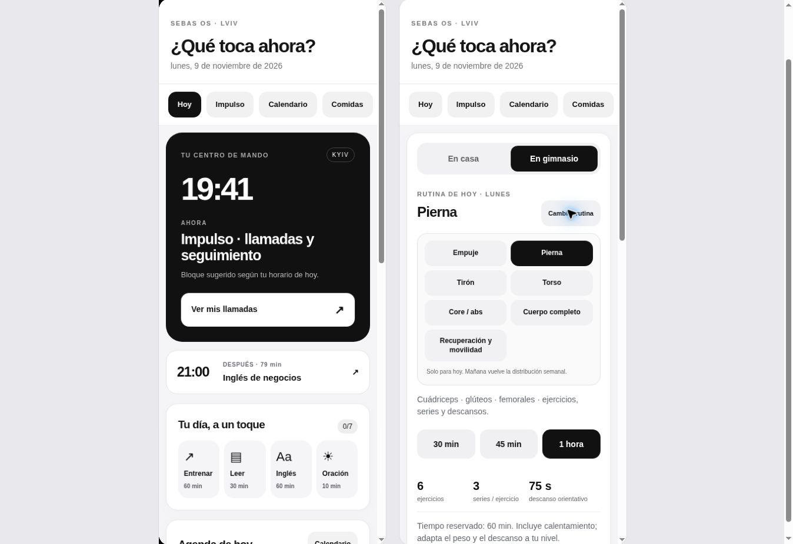
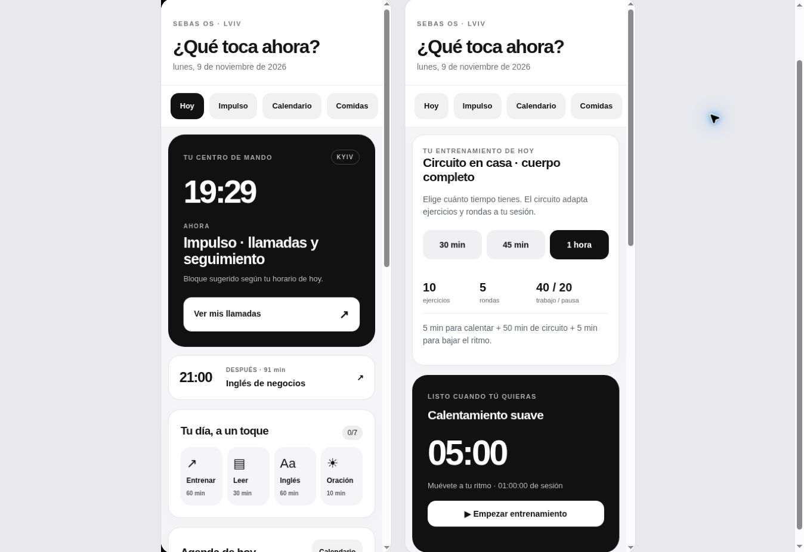

# Verificación 0.6.1

Actualización de PWA: dos pruebas verifican descarga sin caché HTTP con clave de versión, almacenamiento bajo URL canónica y rechazo de instalación incompleta.

Ampliación de Casa / Gimnasio: 43 pruebas aprobadas. Selector de lugar, distribución semanal, override solo para hoy, ejercicios y series según duración. Navegador: cambiar de Casa a Gimnasio, abrir Cambiar rutina, elegir Pierna, iniciar sesión, indicar calentamiento realizado, registrar una serie, pausar, recargar y recuperar la serie y el descanso restante. Frame móvil de 390 px sin overflow.

## Evidencia anterior de 0.6.0

9 noviembre 2026. Continuación del repositorio existente.

- `npm test`: 35 pruebas locales aprobadas. Núcleo de fechas/timers, prioridad horaria, destino y duración de actividades, medianoche/DST, progresión de fases, seguridad de enlaces, lectura en voz alta con adaptador simulado, consultas de proveedores simulados, outbox/reintentos y API HTTP real local.
- `npm run check`: sintaxis correcta en frontend, service worker y backend.
- Navegador Chromium: inicio por hora real de Kyiv, acceso directo a gimnasio, 30/45/60 min con 5/7/10 ejercicios, inicio/pausa de entrenamiento, recuperación tras recarga y acceso al cronómetro de lectura de 30 min. Lectura activa visible en Home y pausa desde Home.
- Inicio sin overflow horizontal en frames de 375, 390, 768 y 1280 px; gimnasio comprobado también en frame de 375 px. Los anchos de contenido útiles son 15 px menores por la barra de scroll de escritorio.
- Configuración: metas fijas de lectura/entrenamiento, estados de servicio privado desconectado y notificaciones deshabilitadas hasta conectarlo.
- YouTube: dos vídeos mostraron bloqueo de reproducción externa del propietario. La app usa un enlace alternativo explícito; no se afirma que se hayan reproducido. Ver workout-sources.md.

No probado: hardware iPhone/Safari, audio real de voz del dispositivo, OAuth del usuario en esta versión, fuentes de Google/Slack a través del nuevo backend o entrega Web Push/APNs con la app cerrada. El backend no está desplegado ni autorizado; ninguna captura contiene leads reales. Las pruebas de reloj usan instantes explícitos y no modifican el reloj del dispositivo.
